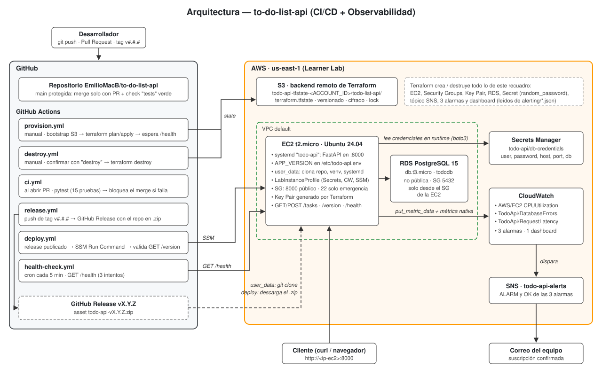

# to-do-list-api

API de tareas (FastAPI + PostgreSQL en RDS) desplegada en AWS con **Terraform**, **GitHub Actions** (CI/CD) y **CloudWatch** (métricas, alarmas, dashboard y correo por SNS).

Práctica 4 — Desarrollo en la Nube (CI/CD + Observabilidad).



## Contenido del repositorio

```
src/                 API: main.py (HTTP), db.py (RDS + Secrets Manager), metrics.py (CloudWatch)
tests/               15 pruebas con pytest (BD y CloudWatch simulados)
terraform/           main.tf, variables.tf, outputs.tf, monitoring.tf, user_data.sh.tftpl
alerting/            alarms.json (3 alarmas con su justificación) y cloudwatch-dashboard.json
scripts/             bootstrap-backend.sh (bucket del tfstate) y deploy-remote.sh (deploy en la EC2)
.github/workflows/   ci, provision, destroy, release, deploy, health-check
docs/                arquitectura.svg / .png y el enunciado
```

## Endpoints

| Método | Ruta | Descripción |
|---|---|---|
| `GET` | `/tasks` | Lista las tareas guardadas en RDS |
| `POST` | `/tasks` | Crea una tarea: `{"title": "...", "done": false}` |
| `GET` | `/version` | Versión desplegada (variable de ambiente `APP_VERSION`) |
| `GET` | `/health` | Estado de la conexión a la BD (`OK`/`FAIL`), versión y hora del servidor. Responde 503 si la BD falla |

```bash
IP=$(terraform -chdir=terraform output -raw public_ip)
curl -X POST http://$IP:8000/tasks -H "Content-Type: application/json" \
  -d '{"title": "estudiar para el examen de desarrollo en la nube", "done": false}'
curl http://$IP:8000/tasks
curl http://$IP:8000/version
curl http://$IP:8000/health
```

## Correr en local

Requisitos: Python 3.12.

```bash
python3.12 -m venv .venv
.venv/bin/pip install -r src/requirements.txt -r requirements-dev.txt

# Pruebas (no necesitan AWS ni base de datos)
.venv/bin/pytest

# Servidor de desarrollo
cd src && METRICS_ENABLED=false ../.venv/bin/uvicorn main:app --reload --port 8000
```

En local no hay RDS: `/version` funciona y `/health` responde `503` con `database: FAIL`, que es el comportamiento esperado. Para hablar con una BD real la app necesita `DB_SECRET_NAME` y `AWS_REGION`, y credenciales de AWS que puedan leer el secret. `METRICS_ENABLED=false` evita que la app intente publicar métricas en CloudWatch.

## Infraestructura

Todo se crea con Terraform: EC2 (t2.micro, Ubuntu 24.04), Security Groups, Key Pair, RDS PostgreSQL 15, el secret `todo-api/db-credentials` en Secrets Manager (password generado con `random_password`), el tópico SNS, las 3 alarmas y el dashboard.

- **Credenciales de la BD:** nunca están en el repositorio. Terraform las guarda en Secrets Manager y la app las lee **al ejecutarse** con boto3 usando el rol `LabInstanceProfile` de la EC2.
- **Arranque:** el `user_data` de la EC2 clona este repositorio, crea un entorno virtual, instala dependencias y registra el servicio systemd `todo-api` en el puerto 8000. No se usa SSH.
- **tfstate remoto:** `s3://todo-api-tfstate-<ACCOUNT_ID>/todo-list-api/terraform.tfstate` (con versionado, cifrado, sin acceso público y bloqueo con `use_lockfile`). El bucket lo crea una sola vez `scripts/bootstrap-backend.sh`, porque el backend no puede gestionarse a sí mismo.

### Secrets de GitHub necesarios

| Secret | Para qué | ¿Vence? |
|---|---|---|
| `AWS_ACCESS_KEY_ID`, `AWS_SECRET_ACCESS_KEY`, `AWS_SESSION_TOKEN` | Credenciales del Learner Lab | **Sí, en cada sesión del lab** |
| `ALERT_EMAIL` | Correo que se suscribe al tópico SNS | No |
| `RELEASE_TOKEN` | PAT fine-grained (Contents: read/write) para crear el Release y que dispare el deploy | Según la fecha del PAT |

Al iniciar cada sesión del lab, copia las credenciales en `~/.aws/credentials` y actualiza los secrets:

```bash
for s in aws_access_key_id aws_secret_access_key aws_session_token; do
  gh secret set $(echo $s | tr a-z A-Z) -R EmilioMacB/to-do-list-api --body "$(aws configure get $s)"
done
```

### Crear la infraestructura

**Con GitHub Actions (recomendado):** Actions → **Provision** → *Run workflow*. El workflow verifica las credenciales, crea el bucket del backend si no existe, corre `terraform init/validate/plan/apply` y espera a que `/health` responda. La URL de la API aparece en el resumen del run.

**Desde tu máquina:**

```bash
./scripts/bootstrap-backend.sh            # solo la primera vez en la cuenta
cd terraform
ACCOUNT_ID=$(aws sts get-caller-identity --query Account --output text)
terraform init -reconfigure -backend-config="bucket=todo-api-tfstate-${ACCOUNT_ID}"
TF_VAR_alert_email="tu-correo@ejemplo.com" terraform apply
terraform output api_url
```

Después de cada creación, AWS manda un correo **"AWS Notification - Subscription Confirmation"**: hay que confirmarlo para recibir las alarmas.

### Destruir la infraestructura

**Con GitHub Actions:** Actions → **Destroy** → *Run workflow* y escribe `destroy` en el campo de confirmación (cualquier otro valor cancela el job).

**Desde tu máquina:** `cd terraform && terraform destroy`.

El bucket del tfstate no se destruye, para poder volver a crear la infraestructura con el mismo backend.

## CI/CD

| Workflow | Disparador | Qué hace |
|---|---|---|
| `ci.yml` | Pull Request a `main` | Corre las 15 pruebas. `main` está protegida: el merge solo se permite si el check `tests` pasa |
| `release.yml` | push de un tag `v#.#.#` | Crea un GitHub Release con el repositorio en `todo-api-<tag>.zip` |
| `deploy.yml` | Release publicado (o manual con un tag) | Por **SSM Run Command** descarga el zip en la EC2, instala dependencias, actualiza `APP_VERSION`, reinicia el servicio (con rollback si falla) y valida `GET /version` |
| `provision.yml` / `destroy.yml` | Manual | Crean / destruyen la infraestructura con Terraform |
| `health-check.yml` | Cada 5 min (cron) + manual | `GET /health` con 3 intentos; el run falla si la API no está sana |

Publicar una versión:

```bash
git switch main && git pull
git tag v1.2.0 && git push origin v1.2.0
```

## Observabilidad

| Métrica | Tipo | Alarma | Umbral |
|---|---|---|---|
| `AWS/EC2 CPUUtilization` | Nativa | `todo-api-ec2-cpu-alta` | > 80 % durante 3 periodos de 5 min |
| `TodoApi/DatabaseErrors` | Propia (`put_metric_data`): errores al leer o escribir en RDS | `todo-api-rds-errores` | ≥ 1 en 1 de 5 periodos de 1 min |
| `TodoApi/RequestLatency` | Propia: latencia de cada petición en ms | `todo-api-latencia-alta` | p95 > 1000 ms en 2 de 3 periodos de 5 min |

Las tres alarmas notifican al tópico SNS `todo-api-alerts` (al entrar en ALARM y al volver a OK). La justificación de cada umbral y la acción esperada están en [`alerting/alarms.json`](alerting/alarms.json) y llegan en el texto del correo. El dashboard `todo-api-dashboard` ([`alerting/cloudwatch-dashboard.json`](alerting/cloudwatch-dashboard.json)) muestra las tres métricas; su URL sale en `terraform output dashboard_url`.

Para probar la alarma de errores de RDS, detén la base de datos y haz peticiones:

```bash
aws rds stop-db-instance --db-instance-identifier todo-api-db
curl http://$IP:8000/tasks      # 503 → DatabaseErrors sube → alarma en ALARM → correo
aws rds start-db-instance --db-instance-identifier todo-api-db
```
